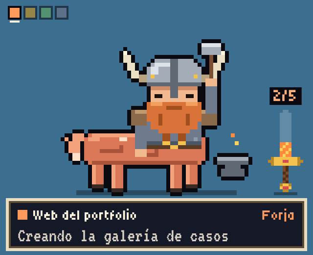
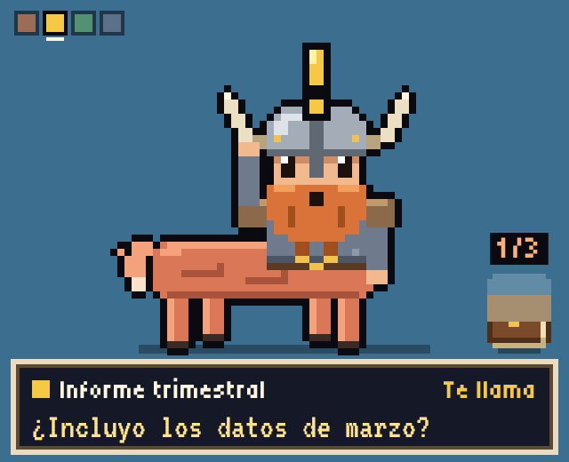
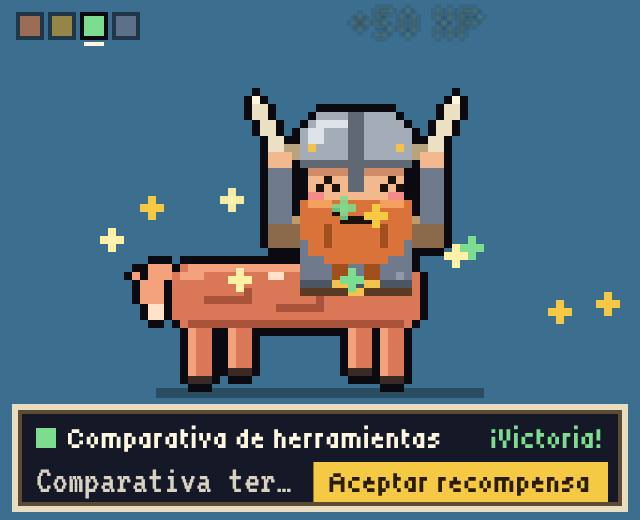
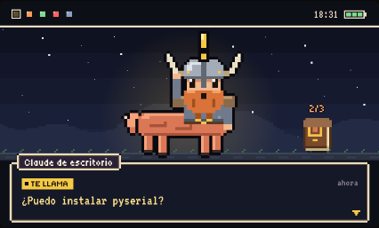

# Centauri, la mascota de CentaurUX

Una mascota de escritorio para Windows que te enseña en qué está trabajando Claude. Es un centauro nórdico en pixel art (torso de guerrero con casco de cuernos y un caballo de luz naranja) que vive en una ventanita transparente, siempre encima del resto.

Está inspirada en la idea de los equipos centauro de CentaurUX: la IA hace el trabajo y la persona decide.

<p>
  
  
  
</p>

## Qué hace

- **Un estado por proyecto.** Descansa, Estudia (pensando), Forja (trabajando), Te llama (espera tu respuesta), ¡Victoria! (terminado) y Herido (algo ha fallado).
- **Forja por pasos.** Si la tarea tiene varios pasos, el centauro forja un objeto pieza a pieza: espada para crear, escudo para revisar, tomo para escribir y catalejo para investigar.
- **Varios proyectos.** Los cuadraditos de arriba son tus proyectos; gira la rueda del ratón para pasar de uno a otro.
- **Aceptar recompensa.** Cuando una tarea termina, pulsa el botón dorado para mandarla a dormir.
- **Pantalla grande.** Haz clic para abrir la vista de 800×480 con el diario de cada misión; Esc para volver.
- **Se mueve.** Arrástrala a donde quieras; de vez en cuando pasea un poco. Clic derecho para el menú (pasear, cambiar de personaje, cerrar).



## Probarla en Windows

1. Descarga `mascota-claude-windows.zip` de la [última versión](../../releases/latest) y descomprímelo en una carpeta, por ejemplo `C:\mascota-claude`.
2. Abre `mascota-claude.exe`. Sin más, verás una demo con proyectos de ejemplo.
3. Para ver datos de verdad, la mascota lee un `estado.json` junto al `.exe` cada 5 segundos. Para probar, renombra `estado-ejemplo.json` (viene en el zip) a `estado.json`.

Necesita Windows 10 u 11 con WebView2, que ya viene instalado en casi todos los equipos.

### Que Claude la avise

Claude actualiza `estado.json` gracias a una habilidad (skill) que le explica cuándo y cómo hacerlo:

1. Copia [`skill/mascota-de-escritorio/SKILL.md`](skill/mascota-de-escritorio/SKILL.md) y cambia la ruta `C:\RUTA\A\mascota-claude\estado.json` por la tuya.
2. Añádela como habilidad en la app de Claude.
3. Dale a Cowork acceso a la carpeta de la mascota.

Solo funciona donde Claude puede escribir en tu ordenador (Cowork con esa carpeta). En un chat normal Claude no tiene acceso a tus archivos, así que la mascota no se entera.

## El archivo de estado

```json
{
  "projects": [
    {
      "name": "Web del portfolio",
      "state": "working",
      "status": "Creando la galería de casos",
      "updatedAt": "2026-01-01T10:00:00Z",
      "forja": {
        "objeto": "espada",
        "nombre": "Espada del portfolio",
        "piezas": [
          { "nombre": "Leer el código", "hecha": true },
          { "nombre": "Galería de casos", "hecha": false }
        ]
      }
    }
  ]
}
```

`state` es uno de `sleeping`, `thinking`, `working`, `waiting`, `happy` o `worried`. `forja` es opcional. Si una tarea se queda en `thinking` o `working` más de 20 minutos sin actualizarse, la mascota la pone a dormir.

## Cómo está hecha

Todo es HTML, CSS y JavaScript sin librerías. La mascota se dibuja en un `<canvas>`: cada personaje es una cuadrícula de letras en el código, y cada letra es un píxel de un color.

- [`prototipo/mascota.html`](prototipo/mascota.html) es el prototipo completo. Ábrelo en el navegador para jugar con él (rueda, clic, mantener pulsado para hablar).
- [`app/`](app/) convierte el prototipo en app de escritorio con [Neutralino.js](https://neutralino.js.org), que usa el motor web que ya trae Windows.

Para compilar la app (necesitas Node.js y Python 3):

```bash
python3 app/build_index.py prototipo/mascota.html app/resources/index.html
cd app
npx @neutralinojs/neu@11.3.1 update
npx @neutralinojs/neu@11.3.1 build
```

El resultado queda en `app/dist/mascota-claude/`: copia `mascota-claude-win_x64.exe` (renómbralo a `mascota-claude.exe` si quieres) y `resources.neu` a la misma carpeta.

## Licencia

MIT. Las fuentes Tiny5 y VT323 se distribuyen con la licencia SIL Open Font License 1.1.
